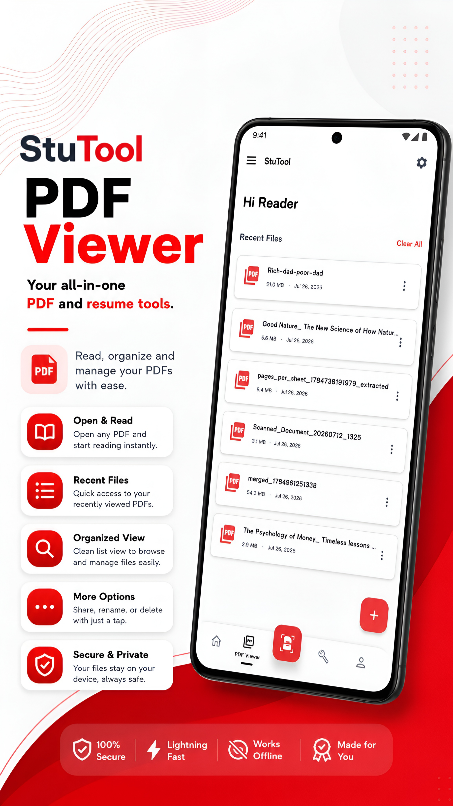
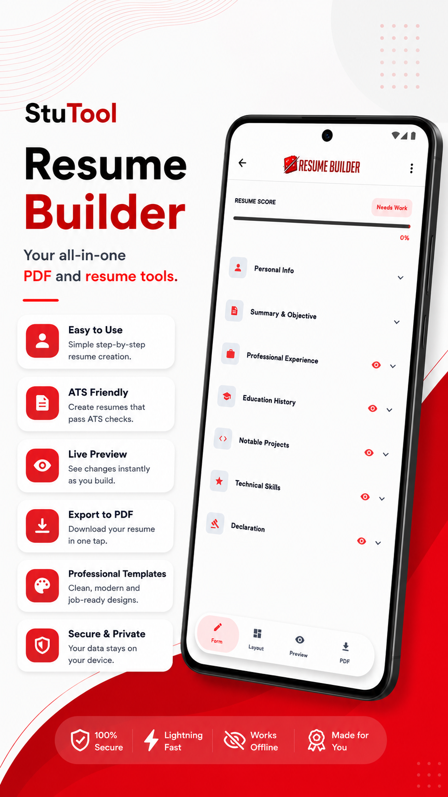
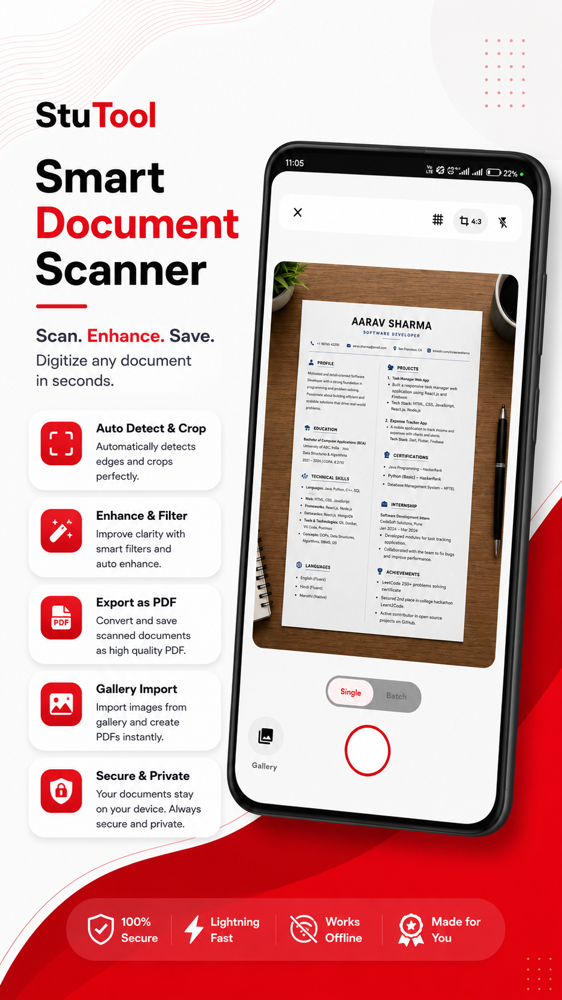
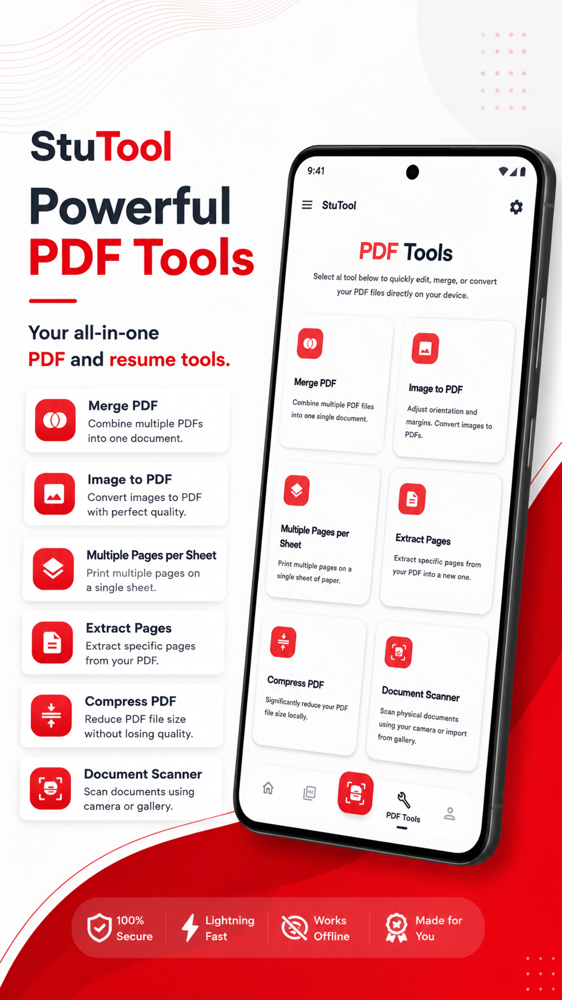

# StuTool

StuTool is a comprehensive productivity application designed for students and professionals. It provides robust PDF manipulation, intelligent resume building, and document scanning features, powered by local image processing and external AI APIs.

## Features

* **PDF Manipulation**: Open, view, and manage PDF documents.
* **Resume Builder**: Create professional, ATS-friendly resumes.
* **Document Scanner**: Scan documents using the device camera with intelligent edge detection and cropping.
* **AI Integration**: Powered by Gemini, Groq, and OpenRouter for advanced intelligent features.
* **Modern UI/UX**: Clean, distraction-free interface with full dark mode and light mode support.

## Screenshots

<!-- Placeholder for screenshots -->
<h2 align="center">📸 Screenshots</h2>

<p align="center">
  
  
  
  
</p>

## Tech Stack

* **Language**: Kotlin
* **UI Framework**: Jetpack Compose
* **Architecture**: MVVM
* **Key Libraries**:
  * PDFBox-Android (PDF manipulation)
  * UCrop (Image cropping)
  * CameraX (Document scanning)
  * Coil (Image loading)
  * Shimmer (Loading animations)

## Build Instructions

1. **Clone the repository**:
   ```bash
   git clone <repository_url>
   cd StuTool
   ```

2. **Setup API Keys**:
   Create a `local.properties` file in the root directory and add your API keys:
   ```properties
   GEMINI_API_KEY=your_gemini_key_here
   GROQ_API_KEY=your_groq_key_here
   OPENROUTER_API_KEY=your_openrouter_key_here
   ```
   *(Note: The app will still build without these keys using placeholder values).*

3. **Build the project**:
   Open the project in Android Studio and sync Gradle, or run from the command line:
   ```bash
   ./gradlew assembleDebug
   ```
